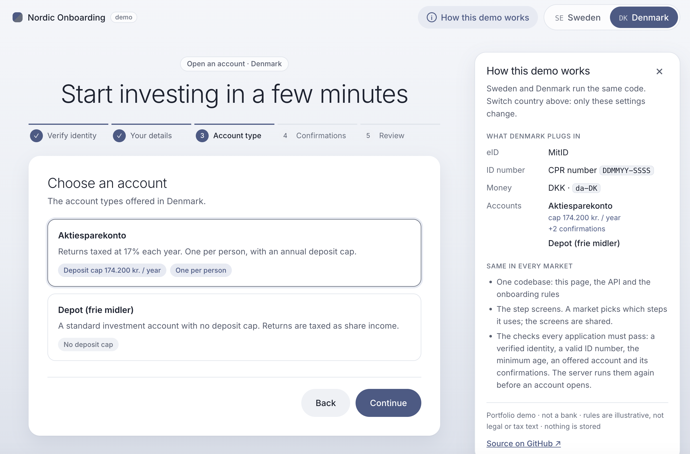
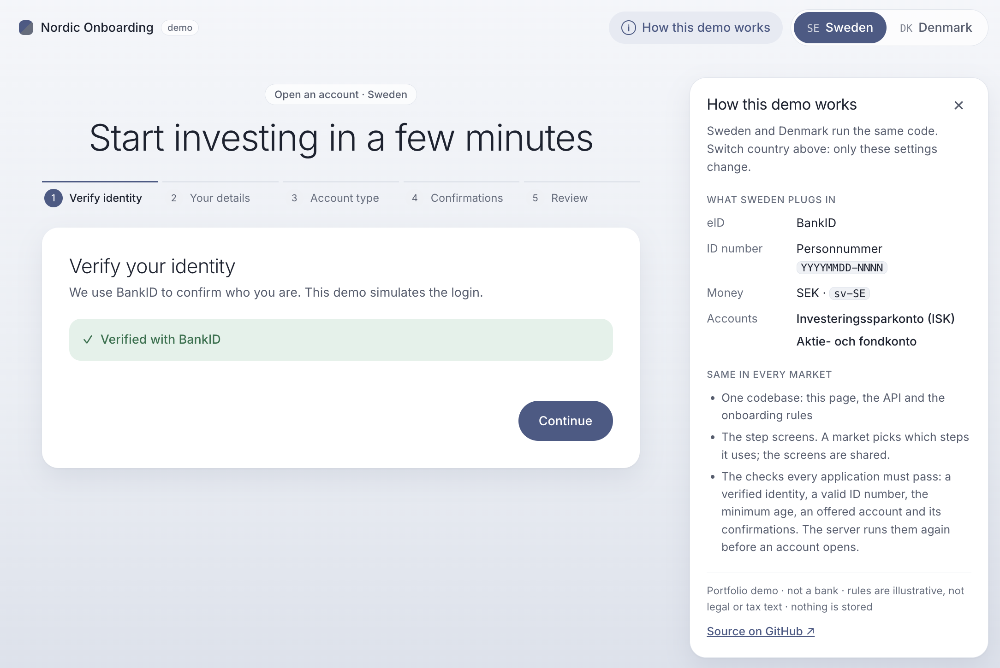
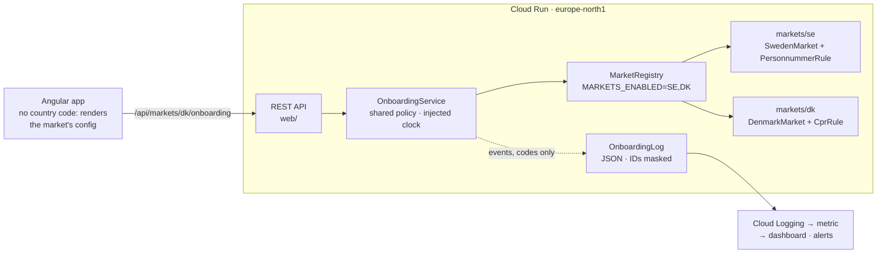
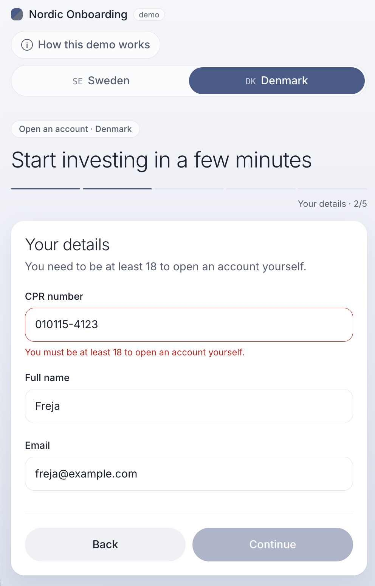
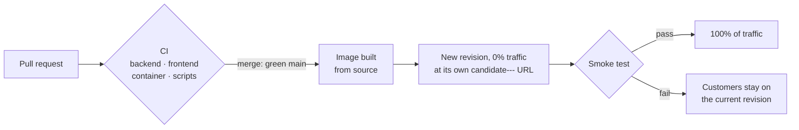
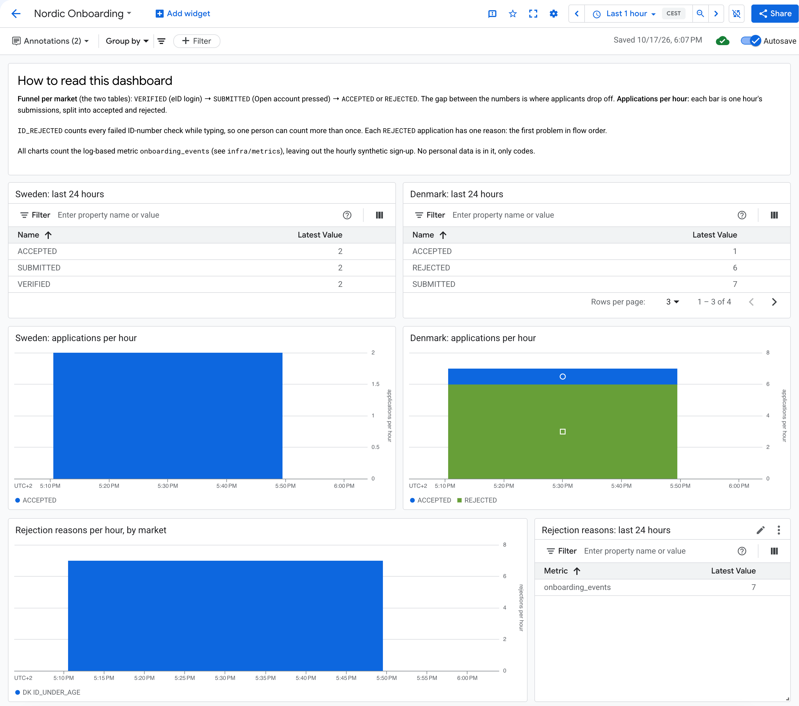
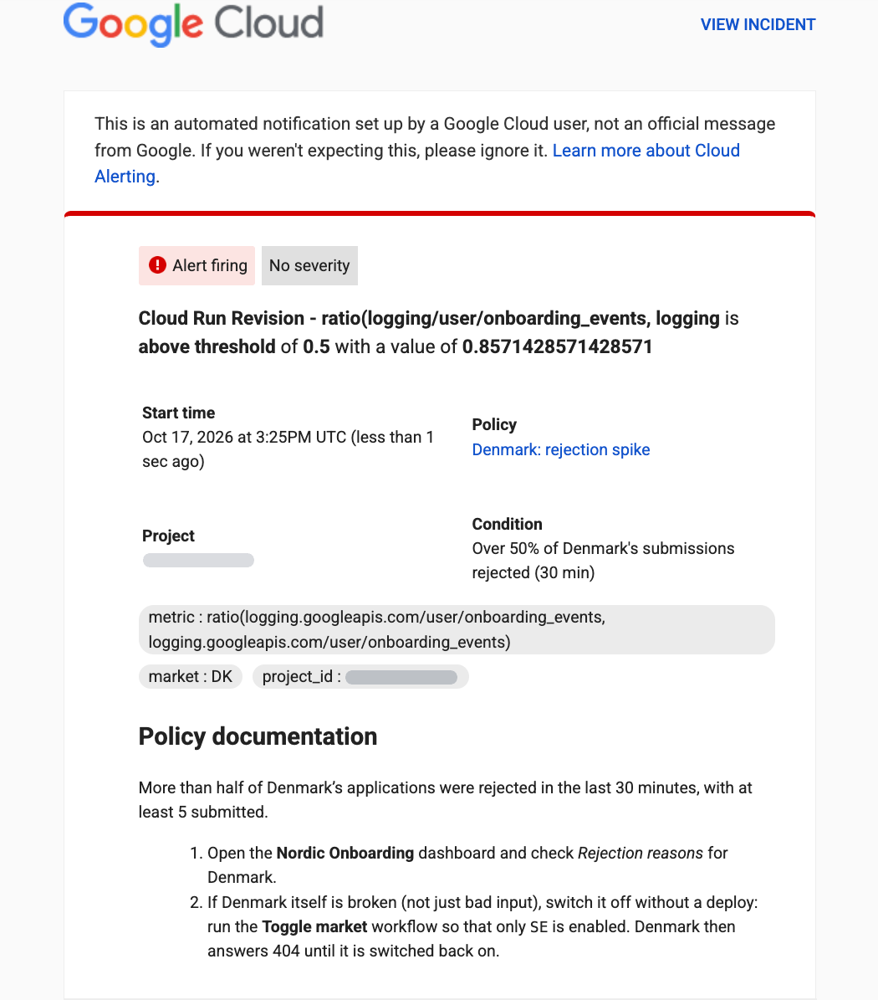

# Nordic Onboarding

This is the account opening flow for a Nordic savings and investment platform that launches in a second country **without forking the code**. Sweden and Denmark use the same onboarding flow. Everything that is different between the two countries lives in a market module, and a market goes live by changing configuration, not by releasing new code.

**Live demo:** https://nordic-onboarding-988672425651.europe-north1.run.app (add `#dk` to the address to start in Denmark)



> This is a personal portfolio project and is not connected to any bank. The product rules are simplified examples, not legal or tax text. The eID login is simulated. When you submit an application, nothing is stored or sent: the app only shows a confirmation.

**Stack:** Angular 21 (standalone components, signals, installable PWA) · Java 25 / Spring Boot 4.1 · GitHub Actions · Google Cloud Run · Cloud Logging and Monitoring

> **Reviewing the code? Start with these five files (about 5 minutes):** [`Market.java`](backend/src/main/java/dev/krishnapriya/onboarding/domain/Market.java) (the contract every market plugs into) → [`DenmarkMarket.java`](backend/src/main/java/dev/krishnapriya/onboarding/markets/dk/DenmarkMarket.java) (Denmark's data in one file, with its ID rule next to it) → [`OnboardingService.java`](backend/src/main/java/dev/krishnapriya/onboarding/domain/OnboardingService.java) (the shared rules, written once) → [`MarketContractTest.java`](backend/src/test/java/dev/krishnapriya/onboarding/domain/MarketContractTest.java) (what every new market must pass) → [`onboarding-flow.ts`](frontend/src/app/onboarding/onboarding-flow.ts) (the screens, with no country-specific code)

## The problem

When a Swedish savings platform launches in Denmark, the risky approach is to add `if (country == "DK")` checks all over the code. Each new market then costs more than the one before, and a change made for one country can break another.

This project takes a different approach. The flow is written once, against a `Market` interface. Each country is a plug-in that supplies its own data and its own rules for reading ID numbers:

| | Sweden | Denmark |
|---|---|---|
| eID | BankID | MitID |
| National ID | Personnummer `YYYYMMDD-NNNN`: Luhn check digit, `+` for age 100+, coordination numbers (day + 60) | CPR number `DDMMYY-SSSS`: century from the 7th digit, and deliberately **no** modulus-11 check (Denmark stopped guaranteeing it in 2007, so checking it would reject real people) |
| Currency · locale | SEK · `sv-SE` | DKK · `da-DK` |
| Time zone | Europe/Stockholm | Europe/Copenhagen |
| Minimum age | 18 | 18 |
| Account types | Investeringssparkonto (ISK), Aktie- och fondkonto | Aktiesparekonto (one per person; deposit cap 166,200 DKK for 2025 and 174,200 DKK for 2026, per skat.dk), Depot |
| Product-specific confirmations | none | Aktiesparekonto: "no other Aktiesparekonto", "fully tax liable to Denmark" |

When you switch between Sweden and Denmark in the app, the same screens change exactly as this table describes: the eID, the ID-number field, the currency and the account types.



## How it fits together



- **The domain is plain Java.** The code in `backend/.../domain` has no Spring or logging imports, so it can be tested without starting anything. An ArchUnit test fails the build if that changes, or if one market starts to depend on another.
- **The shared rules live in one place.** `OnboardingService` checks the same things in every market: a verified identity, a valid ID number, the minimum age, an account type the market offers, and the required confirmations. A market only says how to read its own ID number. The age rule itself is written once.
- **Rules are data.** Denmark's deposit cap is a map from year to amount (`2025 → 166,200`, `2026 → 174,200`), not an `if` statement. Adding a new year's cap means adding one entry.
- **Time comes from an injected clock, read in each market's own time zone.** So an 18th birthday and a new year's cap both start at local midnight, and tests can set "today" to any date.
- **The frontend has no code for any specific country.** The steps, field labels, ID format, account types, caps and confirmations all come from `/api/markets/{code}/onboarding`. The ID number is checked while you type: first against the market's format pattern in the browser, then by the server, which owns the real rule.
- **It can be installed as an app (PWA).** On a phone, "Add to Home Screen" gives it its own icon and window. A service worker keeps a copy of the app, so it can start offline, but it never keeps the API's answers. A cached market configuration could show a market that the kill switch has turned off.



## Adding a third market (Norway)

1. Add `markets/no/NorwayMarket.java` and a `FodselsnummerRule` that implements `NationalIdRule`.
2. Register it in `config/MarketWiring.java` and add it to `MarketContractTest.MARKETS`. The contract tests then check every rule for Norway too: a unique two-letter code, a flow that starts with identity and ends with review, required terms, product-specific confirmations that point to real products, unique ids, a time zone, and a valid demo ID number.
3. Merge. Norway is now deployed but **dark**: the API answers 404 for it, because `NO` is not in `MARKETS_ENABLED`.
4. To launch, add `SE,DK,NO` to the kill switch's choices (a one-line change to its workflow file) and run it. The app itself is not rebuilt or released.

Nothing changes in `OnboardingService`, the controller or the Angular app. Two pieces of operations config name markets on purpose: the kill switch's dropdown, so a typo can't switch a market off, and the dashboard, if you want Norway's funnel next to the others.

## Delivering safely



- **Every change is tested before it reaches main.** CI runs four jobs. The **backend** job runs 114 tests, including ArchUnit and the contract tests. The **frontend** job runs 37 tests and a production build. The **container** job builds the real image and checks that it starts, passes the smoke test, runs as a non-root user, writes JSON logs, completes a synthetic sign-up in both markets, can be installed as a PWA, and goes dark for a market that is switched off. The **scripts** job tests the release and kill-switch logic against a fake `gcloud`.
- **A green main deploys by itself.** GitHub signs in to Google Cloud with Workload Identity Federation, so no keys are stored anywhere, and only this repository's main branch is allowed to deploy. Three separate identities do the work: one deploys, one builds the image, and the app itself runs as one with no permissions at all.
- **Each release is tested privately first.** A new version gets no traffic until its own tagged address passes the smoke test, so a broken build never reaches customers. During a real release, a script called the live API every 2 seconds for 3 minutes and got 86 successful answers out of 86.
- **Rolling back is one command**, with no rebuild: `gcloud run services update-traffic nordic-onboarding --to-revisions=<previous>=100`.
- **The service keeps one warm instance, and at most one instance per version**, because the simulated eID sessions are kept in memory.

## Seeing what happens (observability)

- **Structured logs.** In the container, every log line is JSON in the format Cloud Logging reads. Anything that looks like a Swedish or Danish ID number is masked in every line, including stack traces, and tests prove it.
- **Onboarding events.** Every outcome is recorded with the market, the step and the outcome, plus a reason code when something is rejected: `VERIFIED`, `ID_REJECTED` (for example `ID_UNDER_AGE`), `SUBMITTED`, and then `ACCEPTED` or `REJECTED` with the first problem that stopped the application. The domain reports these events through a small interface. They contain codes only, never personal data.
- **Monitoring as code** in [`infra/`](infra): a log-based metric, the dashboard, an uptime check and two email alerts. They are applied with `infra/apply.sh PROJECT_ID ALERT_EMAIL`, which is safe to run again. Contract tests fail the build if a chart or an alert refers to a field, outcome or reason that the app doesn't produce.
- **An hourly synthetic sign-up** opens an account in each live market in production. Its requests are tagged, so the dashboard and the alerts leave them out.
- **A kill switch.** The "toggle market" workflow sets which markets are live, chosen from a dropdown. It takes about a minute, with no build and no release.



**The incident loop**, which I rehearsed from start to finish:

1. More than half of Denmark's applications are rejected within 30 minutes, so the "Denmark: rejection spike" alert sends an email that says what to do.
2. Actions → **toggle market** → `SE`. A minute later Denmark answers 404, and Sweden is not affected.
3. Fix Denmark and release as usual. Denmark stays dark, because releases never change `MARKETS_ENABLED`.
4. **toggle market** → `SE,DK`, and Denmark is back.



## Tests

| Where | What |
|---|---|
| `PersonnummerRuleTest`, `CprRuleTest` | formats, century rules, check digits, coordination numbers, impossible and future dates, reason codes |
| `OnboardingServiceTest` | deposit cap by year, product-specific confirmations, eID session bound to its market and used once, minimum age to the day and at local midnight, events with reasons |
| `MarketContractTest`, `ArchitectureTest` | the rules every market must follow; the domain stays framework-free and markets stay independent |
| `MarketRegistryTest` | dark markets, and duplicate codes caught even while a market is dark |
| `MarketApiTest`, `UptimeCheckContractTest` | the HTTP contract (404 for dark markets, 422 with field errors, problem details); the health check answers what Google's uptime check expects |
| `CloudLoggingFormatTest`, `StructuredLoggingTest`, `NationalIdMaskTest` | JSON in Cloud Logging's format; ID numbers masked in messages, fields and stack traces |
| `LogMetricContractTest`, `MonitoringConfigContractTest` | the metric, dashboard and alerts use only fields, outcomes and reasons the app writes, and leave synthetic traffic out |
| `market.spec.ts`, `market-api.spec.ts`, `app.spec.ts`, `onboarding-flow.spec.ts` | the helpers, the API client, the market switcher, and the whole flow: eID per market, Continue only when a step is complete, server errors linking back to their step, reset when the market changes, accessibility |
| `service-worker.spec.ts`, `scripts/check-pwa.sh` | the service worker never answers for the API; the real container serves the manifest, icons and worker, so the app can be installed |
| `scripts/*.test.sh` | the release (no traffic until the smoke test passes) and the kill switch (refuses malformed input), against a fake `gcloud` |

## Run it locally

```bash
# API on :8080 (Java 25, Maven)
cd backend && mvn spring-boot:run

# UI on :4200, proxying /api to :8080 (Node 24+)
cd frontend && npm ci && npx ng serve
```

Open `http://localhost:4200/#dk` to start in Denmark. Demo ID numbers: Sweden `19121212-1212` (the tax agency's long-standing test number) and Denmark `121285-1234`. Try `010115-4123` in Denmark to see the age rule, or `19811218-9875` in Sweden to see a wrong check digit.

You can also run everything as one container: `docker build -t nordic-onboarding . && docker run -p 8080:8080 nordic-onboarding`

## How I used AI

I built this together with Claude Code, one numbered step at a time. Each step was its own commit with its tests. It was pushed, checked by CI, and reviewed by me before I merged it. Claude drafted the code and tests from a reference copy. I reviewed the changes, asked questions until I understood them, and made the design decisions. Most fixes were first shown failing in a test, and most new tests were checked by breaking the code they protect.

What I caught myself: a panel that explained each market repeated the same facts for both countries and took attention away from the product, so I had it removed. The app now shows only the onboarding flow. I also noticed a dashboard that looked wrong. It turned out its hourly charts stayed blank when traffic was low, so they are now bar charts.

The assistant flagged the problems below as we went. Before accepting each fix, I checked what the problem would have done to a customer, and where there was a choice, I made the decision:

- **The personnummer century.** The rule chose the century from the year alone, so a 99-year-old born later in the year was rejected as "born in the future".
- **Duplicate market codes.** Two markets with the same code were only detected once one of them was switched on. Now the check fails as soon as the market is deployed, even while it is dark.
- **ID numbers in logs.** Java records print all their fields, including the ID number. Their `toString()` now hides it, and the log format also masks anything that looks like an ID number, as a second safeguard.
- **The wrong "today".** Dates were read in the server's UTC time, so an 18th birthday and a new year's cap started up to two hours late. I chose to give each market its own time zone.
- **Answers arriving in the wrong market.** If you switched market during the login or the submit, the old market's answer could arrive in the new flow. Requests that are still waiting for an answer are now cancelled.
- **Stuck screens.** When the server rejected an eID session, there was no way to log in again, and an ID field that was checked a second time could stay on "Checking…" forever.
- **Deployment pitfalls.** The comma in `MARKETS_ENABLED=SE,DK` would have broken how gcloud reads environment variables, and tagged release candidates were being kept warm and billed.
- **A credentials file in the upload.** The first deploy from CI uploaded GitHub's sign-in file together with the source, to the project's private build bucket. It was not a key: it only worked while that CI job was running, and the job had already finished. The archive was deleted, the file is now ignored, and the release refuses to run if the file would be uploaded again.
- **An alert quieter than intended.** Synthetic sign-ups would have diluted Denmark's rejection rate, so I chose to tag them and leave them out of the charts and alerts.

I also set guardrails for the agent as the build went on: it never runs git commands, changes cloud resources or stops running processes without asking me first.

## Limits, on purpose

- **The eID is simulated, and sessions are kept in memory.** That is why the service runs a single instance per version. A real system would verify a signed assertion from BankID or MitID.
- **No database, no payments, no real customer data.** Nothing that is submitted is stored or sent.
- **The interface text is in English only.** Formats follow each market (DKK and `da-DK` in Denmark), but a Danish customer would still read English labels. The market config already includes a locale, so translated text could be added per market.
- **It runs on a Google Cloud free trial**, so the live demo may stop when the trial ends.
