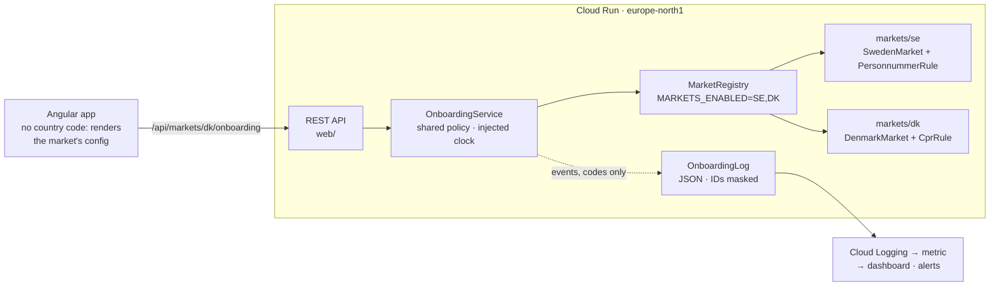
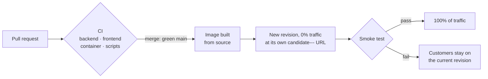

# Nordic Onboarding

Account opening for a Nordic savings and investment platform that launches in a second country **without forking the code**. Sweden and Denmark run through one onboarding flow. Everything that differs between them lives in a market module, and a market goes live by configuration, not by a release.

**Live demo:** https://nordic-onboarding-988672425651.europe-north1.run.app (add `#dk` for Denmark)


> A personal portfolio project, not affiliated with any bank. Product rules are simplified and illustrative, not legal or tax text. The eID login is simulated, and submitting an application stores and sends nothing: it only shows a confirmation.

**Stack:** Angular 21 (standalone components, signals, installable PWA) · Java 25 / Spring Boot 4.1 · GitHub Actions · Google Cloud Run · Cloud Logging and Monitoring

> **Reviewing this? Start here (5 minutes):** [`Market.java`](backend/src/main/java/dev/krishnapriya/onboarding/domain/Market.java) (the plug-in contract) → [`DenmarkMarket.java`](backend/src/main/java/dev/krishnapriya/onboarding/markets/dk/DenmarkMarket.java) (a market's data in one file, with its ID rule beside it) → [`OnboardingService.java`](backend/src/main/java/dev/krishnapriya/onboarding/domain/OnboardingService.java) (shared rules, written once) → [`MarketContractTest.java`](backend/src/test/java/dev/krishnapriya/onboarding/domain/MarketContractTest.java) (what every new market must pass) → [`onboarding-flow.ts`](frontend/src/app/onboarding/onboarding-flow.ts) (a UI with no country code)

## The problem

When a Swedish savings platform launches in Denmark, the risky path is `if (country == "DK")` spreading through the codebase. Every later market then costs more than the one before, and a change for one country can break another.

This repo takes the other path. The flow is written once against a `Market` interface, and a country is a plug-in that supplies data and parsing rules:

| | Sweden | Denmark |
|---|---|---|
| eID | BankID | MitID |
| National ID | Personnummer `YYYYMMDD-NNNN`: Luhn check digit, `+` for age 100+, coordination numbers (day + 60) | CPR number `DDMMYY-SSSS`: century from the 7th digit, and deliberately **no** modulus-11 check (Denmark stopped guaranteeing it in 2007, so checking it would reject real people) |
| Currency · locale | SEK · `sv-SE` | DKK · `da-DK` |
| Time zone | Europe/Stockholm | Europe/Copenhagen |
| Minimum age | 18 | 18 |
| Account types | Investeringssparkonto (ISK), Aktie- och fondkonto | Aktiesparekonto (one per person; deposit cap 166,200 DKK for 2025 and 174,200 DKK for 2026, per skat.dk), Depot |
| Product-specific confirmations | none | Aktiesparekonto: "no other Aktiesparekonto", "fully tax liable to Denmark" |

In the app, **How this demo works** opens a panel beside the flow. Its "What Denmark plugs in" list *is* that configuration, and the flow next to it is the same code for both.


## How it fits together



- **The domain is plain Java.** `backend/.../domain` has no Spring or logging imports, so it's tested without starting anything. An ArchUnit test fails the build if that changes, and also if one market ever depends on another.
- **Shared policy lives once.** Identity verified, a valid ID number, minimum age, the product offered in that market, the required confirmations: `OnboardingService` checks these the same way everywhere. A market only says *how to read* its ID number; the age rule itself is never duplicated.
- **Rules are data.** Denmark's deposit cap is a dated map (`2025 → 166,200`, `2026 → 174,200`), not an `if`. A new year's cap is one entry.
- **Time comes from an injected clock, read in each market's own time zone**, so an 18th birthday and the new year's cap both start at local midnight, and tests can pin "today".
- **The frontend never branches on a market code.** The steps, field labels, ID format, products, caps and confirmations all come from `/api/markets/{code}/onboarding`. The ID number is checked as you type: first against the market's format pattern, then by the server, which owns the real rule.
- **It installs as an app (PWA).** On a phone, "Add to Home Screen" gives it its own icon and window. A service worker keeps the app itself for an offline start, but never the API's answers: a cached market config could show a market the kill switch has turned off.


## Adding a third market (Norway)

1. Add `markets/no/NorwayMarket.java` and a `FodselsnummerRule` implementing `NationalIdRule`.
2. Register it in `config/MarketWiring.java` and add it to `MarketContractTest.MARKETS`. The contract suite then runs every rule for Norway too: a unique two-letter code, a flow that starts with identity and ends with review, required terms, product-specific confirmations that point at real products, unique ids, a time zone, and a demo ID number that is valid.
3. Merge. Norway is deployed but **dark**: the API answers 404 for it, because `NO` isn't in `MARKETS_ENABLED`.
4. Launch: add `SE,DK,NO` to the kill switch's choices (a one-line change to its workflow file) and run it. The app itself isn't rebuilt or released.

No change to `OnboardingService`, the controller or the Angular app. Two pieces of operations config name markets on purpose: the kill switch's dropdown (so a typo can't switch a market off) and the dashboard, if you want Norway's funnel next to the others.

## Delivering safely



- **Every change is tested before it reaches main**, in four jobs. The **backend** runs 114 tests, including ArchUnit and the contract tests; the **frontend** runs 38 tests and a production build. The **container** job builds the real image and checks that it starts, passes the smoke test, runs as non-root, logs JSON, completes a synthetic sign-up in both markets, can be installed as a PWA, and goes dark for a market that's switched off. The **scripts** job tests the release and kill-switch logic against a fake `gcloud`.
- **Green main ships by itself.** GitHub signs in to Google with Workload Identity Federation: no stored keys, and only this repo's main branch can deploy. Three narrow identities do the work: one deploys, one builds the image, and the app runs as one with no permissions at all.
- **Releases are tested in private first.** A new version gets no traffic until its own tagged address passes the smoke test, so a broken build never reaches customers. During a real release, a script calling the live API every 2 seconds got 86 out of 86 successful answers over 3 minutes.
- **Rolling back is one command**, with no rebuild: `gcloud run services update-traffic nordic-onboarding --to-revisions=<previous>=100`.
- **One warm instance, and at most one per version**, because the simulated eID sessions live in memory.

## Seeing what happens (observability)

- **Structured logs.** In the container, every log line is JSON in the shape Cloud Logging reads. Anything shaped like a Swedish or Danish ID number is masked in every line, stack traces included, and tests prove it.
- **Onboarding events.** Each outcome is recorded with market, step and outcome, plus a reason code for rejections: `VERIFIED`, `ID_REJECTED` (for example `ID_UNDER_AGE`), `SUBMITTED`, then `ACCEPTED` or `REJECTED` with the first problem that stopped the application. The domain reports them through a small interface; they hold codes only, never personal data.
- **Monitoring as code** in [`infra/`](infra): a log-based metric, the dashboard, an uptime check and two email alerts, applied with `infra/apply.sh PROJECT_ID ALERT_EMAIL` (safe to re-run). Contract tests fail the build if a chart or alert refers to a field, outcome or reason the app doesn't produce.
- **An hourly synthetic sign-up** opens an account in each live market against production. Its requests are tagged, so the dashboard and alerts leave them out.
- **A kill switch.** The "toggle market" workflow sets which markets are live from a dropdown, in about a minute, with no build and no release.


**The incident loop**, rehearsed end to end:

1. More than half of Denmark's applications are rejected within 30 minutes, so the "Denmark: rejection spike" alert emails, saying what to do.
2. Actions → **toggle market** → `SE`. A minute later Denmark answers 404, and Sweden is untouched.
3. Fix Denmark and release as usual. It stays dark, because releases never touch `MARKETS_ENABLED`.
4. **toggle market** → `SE,DK`, and Denmark is back.


## Tests

| Where | What |
|---|---|
| `PersonnummerRuleTest`, `CprRuleTest` | formats, century rules, check digits, coordination numbers, impossible and future dates, reason codes |
| `OnboardingServiceTest` | deposit cap by year, product-specific confirmations, eID session bound to its market and used once, minimum age to the day and at local midnight, events with reasons |
| `MarketContractTest`, `ArchitectureTest` | rules every market must follow; the domain stays framework-free and markets independent |
| `MarketRegistryTest` | dark markets, duplicate codes caught even while dark |
| `MarketApiTest`, `UptimeCheckContractTest` | HTTP contract (404 for dark markets, 422 with field errors, problem details); the health check answers what Google's uptime check expects |
| `CloudLoggingFormatTest`, `StructuredLoggingTest`, `NationalIdMaskTest` | JSON in Cloud Logging's shape; ID numbers masked in messages, fields and stack traces |
| `LogMetricContractTest`, `MonitoringConfigContractTest` | the metric, dashboard and alerts only use fields, outcomes and reasons the app writes, and leave synthetic traffic out |
| `market.spec.ts`, `market-api.spec.ts`, `app.spec.ts`, `onboarding-flow.spec.ts` | helpers, the API client, the market switcher, and the whole flow: eID per market, gating on Continue, server errors linking back, reset on switching market, accessibility |
| `service-worker.spec.ts`, `scripts/check-pwa.sh` | the service worker never answers for the API; the real container serves the manifest, icons and worker so the app can be installed |
| `scripts/*.test.sh` | release (no traffic until the smoke test passes) and kill switch (refuses malformed input) against a fake `gcloud` |

## Run it locally

```bash
# API on :8080 (Java 25, Maven)
cd backend && mvn spring-boot:run

# UI on :4200, proxying /api to :8080 (Node 24+)
cd frontend && npm ci && npx ng serve
```

Open `http://localhost:4200/#dk` to start in Denmark. Demo ID numbers: Sweden `19121212-1212` (the tax agency's long-standing test number), Denmark `121285-1234`. Try `010115-4123` in Denmark to see the age rule, or `19811218-9875` in Sweden for a wrong check digit.

Or as one container: `docker build -t nordic-onboarding . && docker run -p 8080:8080 nordic-onboarding`

## How AI was used

I built this pair-programming with Claude Code, one numbered step at a time. Each step was its own commit with its tests, pushed and checked by CI, and reviewed by me before merging. Claude drafted code and tests from a reference copy; I reviewed the diffs, asked questions until I understood them, and made the design calls. Most fixes were first shown failing in a test, and most new tests were checked by breaking the code they guard.

What I caught myself: the market panel repeated the same facts for both countries, so I asked for the page to be redesigned around a single "How this demo works" panel. And a dashboard that looked wrong to me turned out to have hourly charts that stayed blank at low traffic; they're now bar charts.

The assistant flagged these problems along the way. I checked what each one would have done to a customer before accepting the fix, and made the call where there was a choice:

- **A real person rejected.** The personnummer rule chose the century by year alone, so a 99-year-old born later in the year was rejected as "born in the future".
- **A launch-day surprise.** Two markets with the same code were only detected once one was switched on. Now it fails when the market ships dark.
- **ID numbers in logs.** Java records print all their fields, including the ID number. Their `toString()` now hides it, and the log format masks anything ID-shaped as a second line of defence.
- **The wrong "today".** Dates were read in the server's UTC, so an 18th birthday and a new year's cap started up to two hours late. I chose to give each market its own time zone.
- **Answers landing in the wrong market.** Switching market mid-login or mid-submit let the old market's answer arrive in the new flow. Pending requests are now cancelled.
- **Stuck screens.** A rejected eID session left no way to log in again, and a re-validated ID field could sit on "Checking…" forever.
- **Deploy pitfalls.** `MARKETS_ENABLED=SE,DK` would have broken gcloud's variable parsing, and tagged release candidates were being kept warm and billed.
- **A credentials file in the upload.** The first deploy from CI uploaded GitHub's sign-in file with the source, to the project's private build bucket. It wasn't a key: it only worked while that CI job ran, and the job had finished. The archive was deleted, the file is now ignored, and the release refuses to run if it would be uploaded again.
- **A quieter alert than intended.** Synthetic sign-ups would have diluted Denmark's rejection rate, so I chose to tag them and leave them out of charts and alerts.

I also set guardrails for the agent as the build went on: it never runs git commands, changes cloud resources or stops running processes without asking first.

## Limits, on purpose

- **eID is simulated, and sessions live in memory.** That's why the service runs a single instance per version. A real system would verify a signed assertion from BankID or MitID.
- **No database, no payments, no real customer data.** Nothing submitted is stored or sent.
- **The interface text is English only.** Formats follow each market (DKK and `da-DK` in Denmark), but a Danish customer would read English labels. The market config already carries a locale, so translated text could be supplied per market.
- **It runs on a Google Cloud free trial**, so the live demo may pause when the trial ends.
